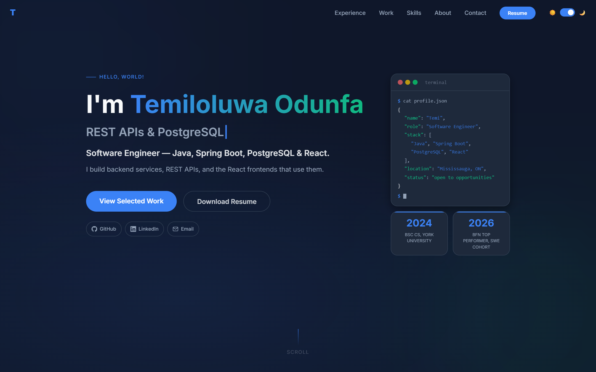
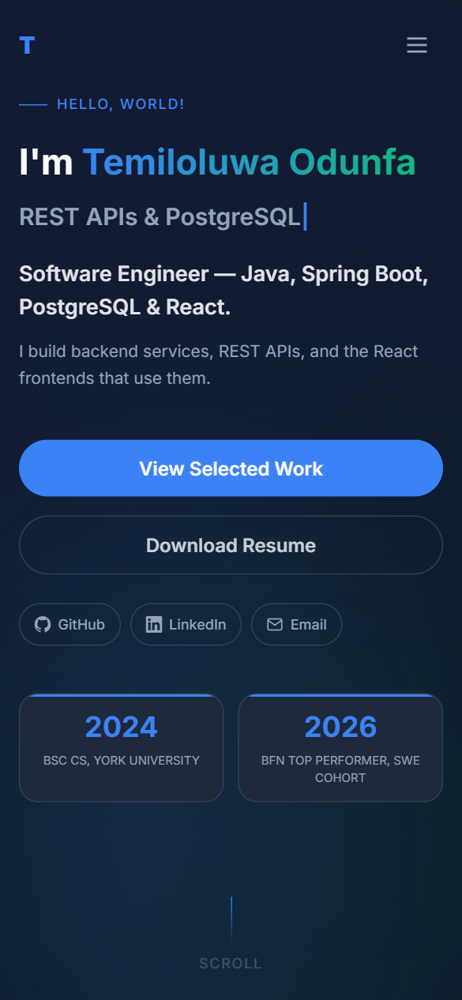

# Temiloluwa Odunfa — Portfolio

My personal software engineering portfolio, showcasing professional experience, selected projects, and technical skills.

Built with Next.js, React, and Tailwind CSS, with an emphasis on responsive design, accessibility, performance, and maintainable code.

**Live website:** https://my-portfolio-nine-omega-88.vercel.app

<p>
  
  
</p>

## What's on the site

- **Experience:** contract work at 4RHD Solutions (AIGuardium and a hotel property-management system) and a 2023 junior developer contract at TAGOPUS
- **Selected work:** TrackLo, UserManager, and a library management system, each with source links and a live demo
- **Skills, About, Contact:** skills mirror the downloadable resume

## Engineering highlights

- **One source for contact data.** `app/data/site.js` holds links, location, the resume path, and the analytics ID. The nav, hero, contact section, and page metadata all read from it.
- **Server Components where possible.** The hero and contact section render on the server. Client components are used only where state or browser APIs are needed: the nav, typewriter, scroll reveals, the TrackLo stage explorer, and analytics.
- **Animation that doesn't hold content back.** The hero entrance is CSS keyframes staggered with a `--delay` custom property, so it runs before hydration. Sections reveal through a small `IntersectionObserver` hook (`useReveal`).
- **Accessibility.** Motion respects `prefers-reduced-motion`. The closed mobile drawer is `inert` and Escape closes it. The nav marks the current section with `aria-current`. The TrackLo stage explorer uses `aria-pressed` buttons and a polite live region.
- **Privacy-friendly analytics.** Umami Cloud is cookieless, records only on the production domain, and honours Do Not Track. Custom event tracking uses delegated listeners and `data-track` attributes without interfering with existing UI interactions.
- **Link previews.** Title, description, Open Graph, and Twitter tags come from the Next.js Metadata API with `metadataBase`.

## Tech stack

Next.js 16 (App Router) · React 19 · JavaScript · Tailwind CSS 4 · `next/font` · react-icons · ESLint 9 · Umami Cloud · Vercel · GitHub Actions

## Project structure

```
app/
  layout.js           Root layout: metadata, font, theme init, analytics
  page.js             Section order
  globals.css         Light/dark theme tokens and motion rules
  data/site.js        Contact links, resume path, analytics ID
  hooks/useReveal.js  Reveal-on-scroll hook
  components/         One component per section, plus shared icons,
                      ContactLinks, RotatingRoles, and Analytics
public/               Resume PDF, project screenshots, Open Graph image
docs/screenshots/     Images used in this README
```

## Running locally

Requires Node.js 20.9 or later.

```bash
npm ci          # install exact dependency versions
npm run dev     # http://localhost:3000
npm run lint    # ESLint
npm run build   # production build
```

## Updating content

| To change | Edit |
|---|---|
| Links, email, location | `app/data/site.js` |
| Resume | Replace `public/Temiloluwa_Odunfa_Resume.pdf`, keeping the file name |
| Projects, live-demo availability | `app/components/Projects.js` (`demoAvailable`, `freeTierBackend`) |
| Experience | `app/components/Experience.js` |
| Skills | `app/components/Skills.js` (keep in sync with the resume) |

## Deployment

Vercel deploys `master` to production on every push. GitHub Actions runs lint and a production build on every push to `master` and on pull requests. These checks report status only; they don't block a merge or a deployment unless branch protection is configured.

© Temiloluwa Odunfa. All rights reserved.
